# Alternative Transport — Application mobile Flutter

Application de **location de véhicules électriques en libre-service**, développée avec Flutter (Dart) et un backend Node/Express + SQLite. L'interface est en français et reproduit les 21 maquettes du projet.

<p align="center">
  <em>« Roulez plus propre, aujourd'hui et demain. »</em>
</p>

---

## ✨ Fonctionnalités

- **Parcours d'inscription complet** : création de compte, vérification e-mail (OTP), scan CIN recto/verso et permis de conduire, écran de validation.
- **Recherche de véhicules** : accueil avec carte, filtres (type, marque, autonomie, prix, équipements), liste et carte interactive.
- **Réservation** : fiche véhicule détaillée, choix des dates/heures, calcul du prix + frais de service, confirmation.
- **Accès au véhicule** : code d'accès temporaire (15 min), appairage Bluetooth simulé, écran de contrôle (déverrouiller / verrouiller / démarrer / localiser).
- **Trajet** : suivi en cours de route (durée, distance, coût), arrêt et récapitulatif avec empreinte carbone évitée.
- **Compte** : historique des réservations, profil, informations personnelles, documents, moyens de paiement, préférences, aide & support.

## 🧱 Stack technique

| Couche | Technologie |
|---|---|
| Application | Flutter 3.x / Dart 3.x |
| État | Riverpod 2.6 |
| Réseau | package `http` (client API maison) |
| Backend | Node.js + Express 5 |
| Base de données | SQLite (`better-sqlite3`) |
| Authentification | bcrypt (12 rounds) |
| Déploiement | Docker / Docker Compose + Nginx (Flutter Web) |

## 📁 Structure du projet

```
alternative_transport_app/
├── lib/
│   ├── core/            # constantes, thème, routeur, validateurs, formatters
│   ├── data/
│   │   ├── models/      # User, Vehicle, Reservation, Trip, AccessCode, Document…
│   │   ├── repositories/# accès aux données (auth, véhicules, réservations…)
│   │   └── services/    # ApiClient, BleService (simulé), MockData
│   ├── providers/       # état Riverpod (auth, véhicules, trajets, BLE…)
│   ├── screens/         # 27 écrans (auth, home, map, key, profile, …)
│   ├── widgets/         # composants réutilisables (boutons, cartes, nav…)
│   └── main.dart
├── backend/             # API Express + SQLite + Dockerfile
├── docker/nginx.conf    # SPA Flutter + proxy /api
├── assets/images/       # visuels extraits des maquettes
├── docker-compose.yml
├── DOCKER_DEMARRER.bat
└── README_DOCKER.md
```

## 🚀 Démarrage rapide

### 1. Application seule (mode démo, sans backend)

```bash
flutter pub get
flutter run -d chrome     # ou -d windows / -d <appareil>
```

En l'absence de backend, l'application bascule automatiquement en **mode démonstration**.

### 2. Application + API (Docker)

```bash
docker compose up -d --build
```

| Service | URL |
|---|---|
| Application web | http://localhost:8080 |
| API + health check | http://localhost:3000/api/health |

Ou double-cliquez sur `DOCKER_DEMARRER.bat` (Windows). Détails : [README_DOCKER.md](README_DOCKER.md).

### 3. Backend seul

```bash
cd backend
npm install
npm start        # http://localhost:3000
```

## 🔑 Compte de démonstration

| Champ | Valeur |
|---|---|
| E-mail | `demo@alternative.tn` |
| Mot de passe | `demo1234` |
| Code OTP | n'importe quel code à 6 chiffres |

Le compte est créé automatiquement dans la base au démarrage du backend.

## 🔌 API

| Méthode | Route | Description |
|---|---|---|
| `GET` | `/api/health` | État du serveur |
| `POST` | `/api/register` | Création de compte (mot de passe ≥ 8 caractères) |
| `POST` | `/api/login` | Connexion, renvoie l'utilisateur |

L'URL de l'API est résolue automatiquement selon la plateforme :

- Chrome / Windows / web : `http://localhost:3000/api`
- Émulateur Android : `http://10.0.2.2:3000/api`
- Surcharge possible : `flutter run --dart-define=API_BASE_URL=http://192.168.1.10:3000/api`

## 📱 Écrans

Splash · Bienvenue · Notre marque · Connexion · Inscription · Vérification e-mail · Scan CIN (recto/verso) · Scan permis · Vérification des documents · Accueil · Filtres · Carte · Détail véhicule · Réservation · Code d'accès · Connexion Bluetooth · Contrôle du véhicule · Trajet en cours · Récapitulatif · Mes réservations · Profil · Informations personnelles · Documents · Moyens de paiement · Préférences · Aide & support

## 📸 Captures d'écran

Les 24 captures sont dans [`docs/screenshots/`](docs/screenshots) et la planche complète est dans
[`docs/galerie.html`](docs/galerie.html) (à ouvrir dans un navigateur).

| | | | |
|:--:|:--:|:--:|:--:|
| **01** Bienvenue<br>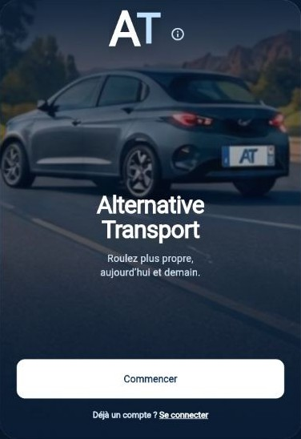 | **02** Notre marque<br>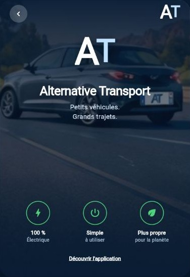 | **03** Connexion<br>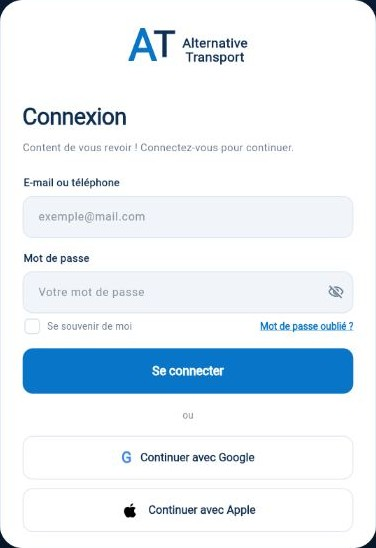 | **04** Inscription<br>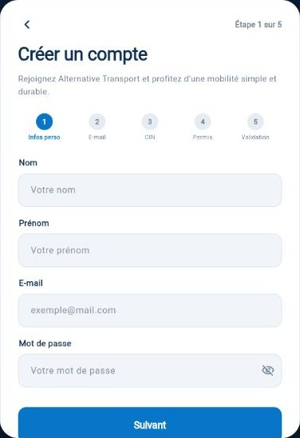 |
| **05** Vérification e-mail<br>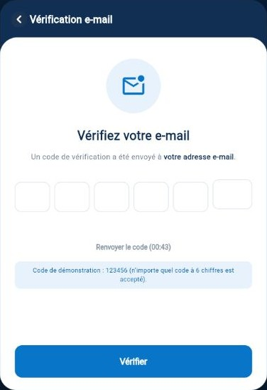 | **06** Scan CIN (recto)<br>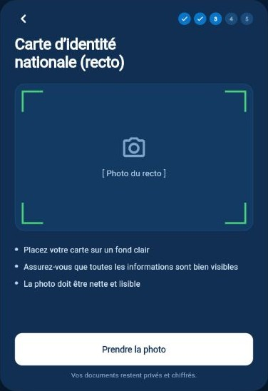 | **07** Vérification des documents<br>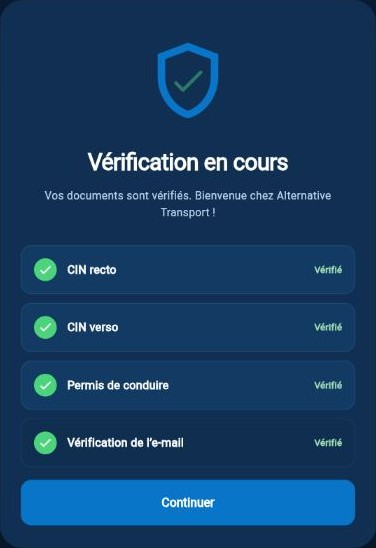 | **08** Accueil<br>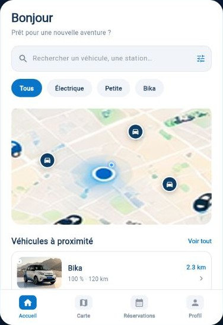 |
| **09** Filtres<br>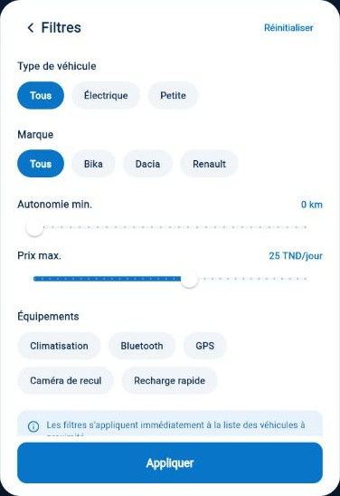 | **10** Carte<br>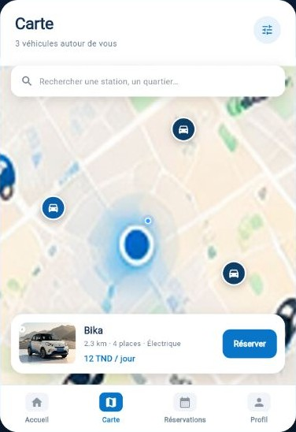 | **11** Détail véhicule<br>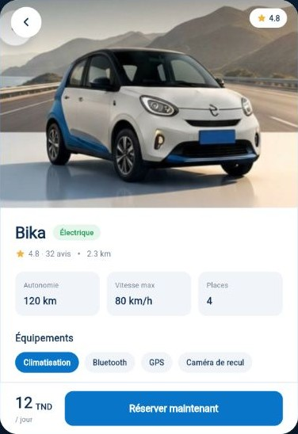 | **12** Réservation<br>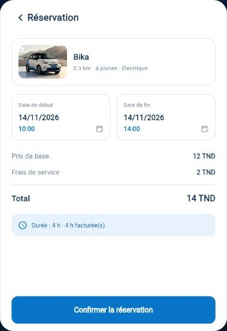 |
| **13** Code d'accès<br>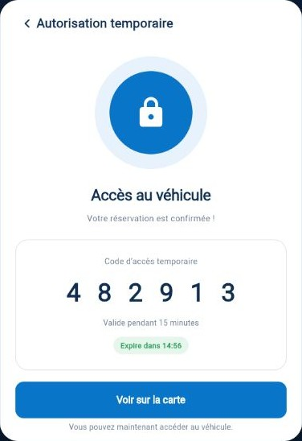 | **14** Connexion Bluetooth<br>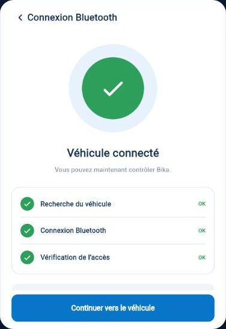 | **15** Contrôle du véhicule<br>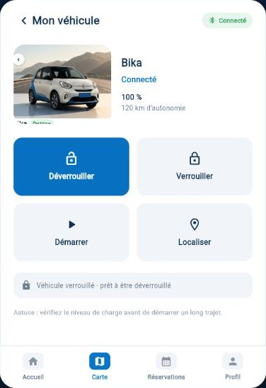 | **16** Trajet en cours<br>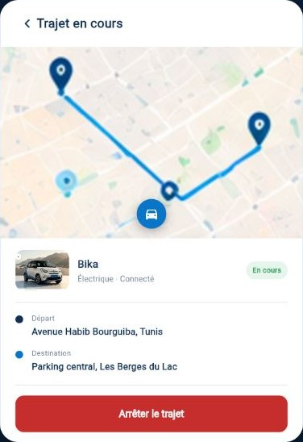 |
| **17** Récapitulatif du trajet<br>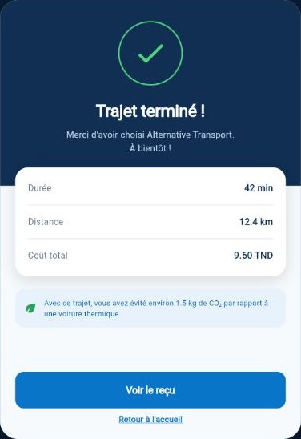 | **18** Mes réservations<br>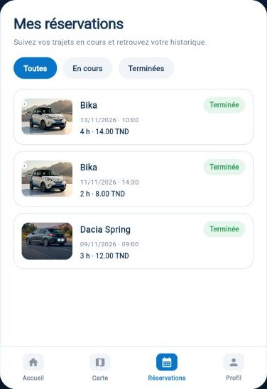 | **19** Profil<br>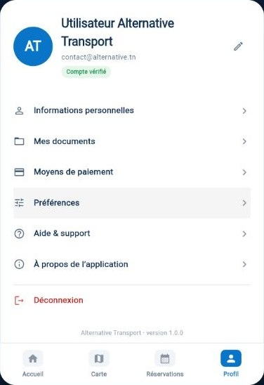 | **20** Informations personnelles<br>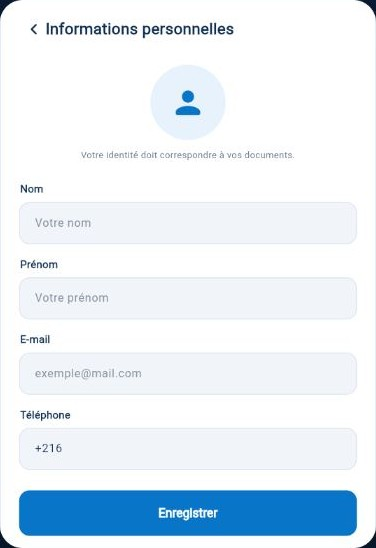 |
| **21** Mes documents<br>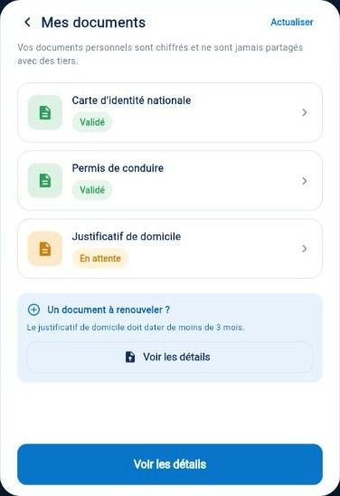 | **22** Moyens de paiement<br>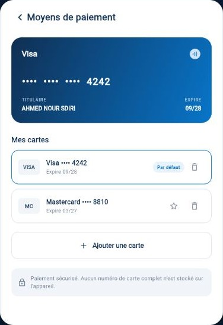 | **23** Préférences<br>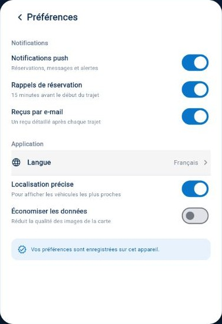 | **24** Aide & support<br>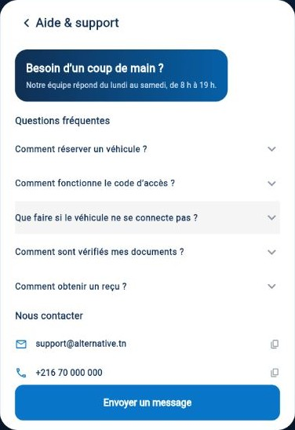 |

## 🎬 Vidéo de démonstration

> Démonstration complète de l'application : inscription, vérification des documents,
> recherche et réservation d'un véhicule, accès par code / Bluetooth, trajet et récapitulatif.

**▶️ Vidéo :** _lien à ajouter_ — dépose la vidéo ici : `docs/video/demo.mp4`
(ou indique un lien YouTube / Drive pour l'intégrer directement dans ce README).


## 🧪 Qualité

```bash
flutter analyze     # aucune erreur
flutter test        # tests
```

## 📄 Licence

Projet académique (PFA) — usage pédagogique.
